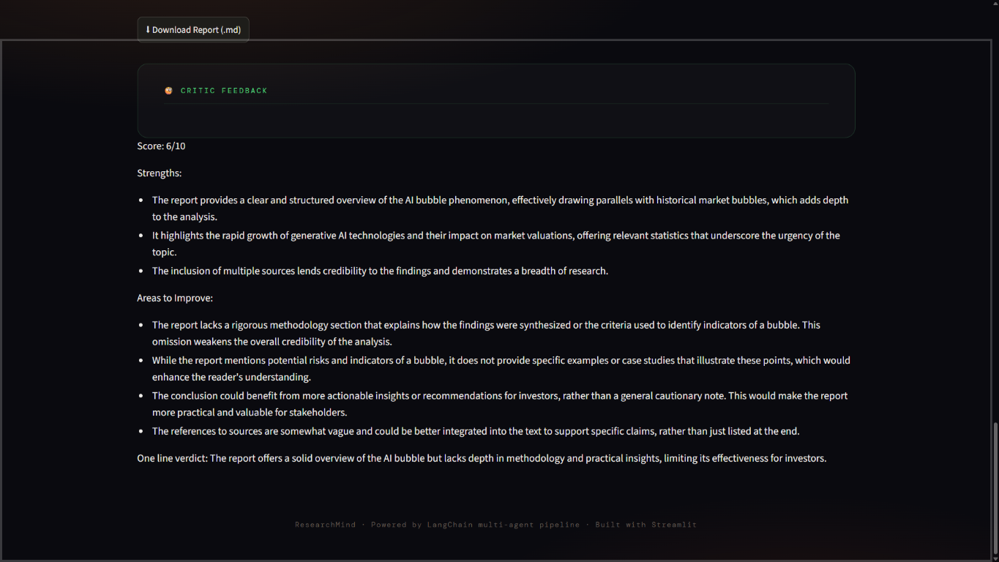
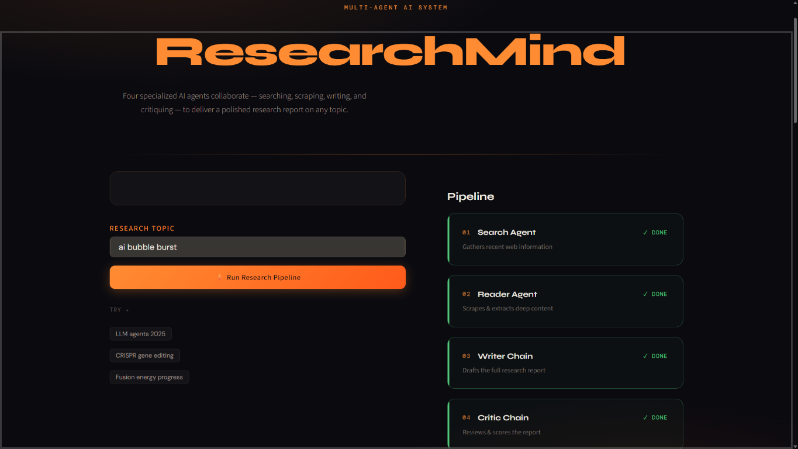
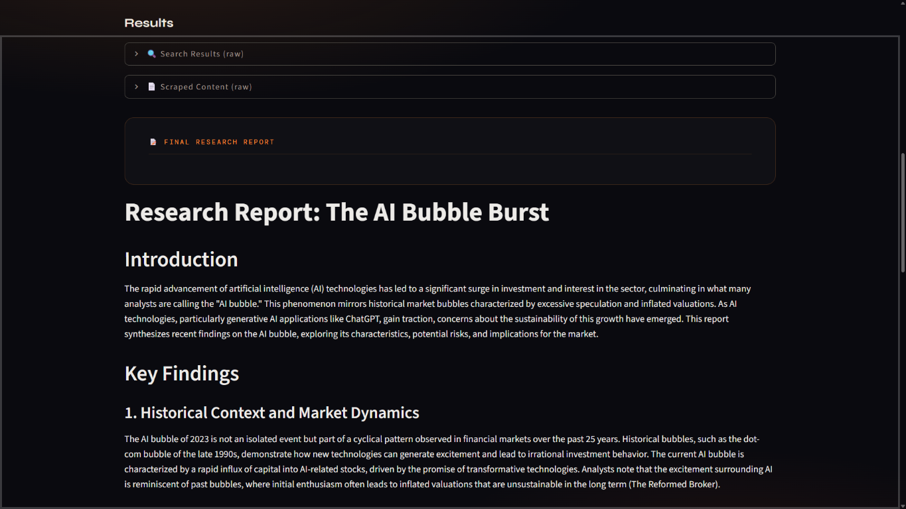
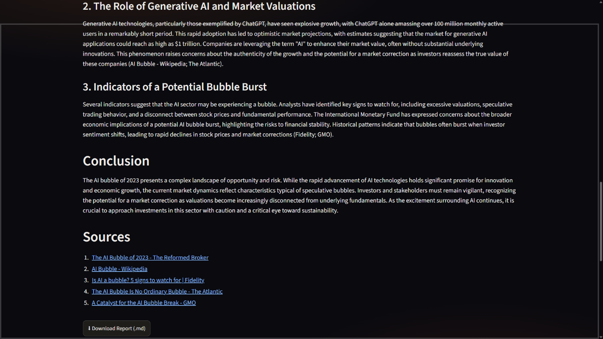

# ResearchMind

ResearchMind is a multi-agent AI research system built with LangChain and Streamlit. It turns a simple topic into a polished research report by coordinating four specialized agents: a search agent, a reader agent, a writing agent, and a critic that reviews the final output.

The project is designed to mimic a real research workflow: gather recent web information, extract the most relevant source material, synthesize the findings into a structured report, and evaluate the quality of the result before presenting it to the user.

## Why this project exists

Many AI tools can answer a question in one shot, but research workflows benefit from structure, ranking, and critique. This project demonstrates how a multi-agent pipeline can:

- search for current and reliable sources,
- scrape the most relevant content,
- write a structured report,
- review and score the report for quality.

## Architecture overview

The system is built around a small but effective pipeline:

1. Search Agent
   - Uses Tavily search to find recent and relevant web results.
2. Reader Agent
   - Selects the strongest source and scrapes it for deeper text.
3. Writer Chain
   - Combines search results and scraped content into a full research report.
4. Critic Chain
   - Reviews the finished report and provides a score with strengths and improvement areas.

## Project structure

- `app.py` – Streamlit frontend and orchestration logic for the UI and pipeline.
- `agents.py` – LangChain model setup, agent builders, and prompt chains for writing/critic workflows.
- `tools.py` – Web search and scraping tools exposed to agents.
- `pipeline.py` – CLI-style runner for executing the same research flow in a terminal.
- `requirements.txt` – Python dependencies for the project.

## Tech stack

- Python
- Streamlit
- LangChain
- LangChain OpenAI
- Tavily Search API
- BeautifulSoup
- Requests
- OpenAI GPT models

## Environment setup

1. Create and activate a virtual environment.
2. Install dependencies:

```bash
pip install -r requirements.txt
```

3. Add your API keys to a `.env` file:

```env
OPENAI_API_KEY=your_openai_key
TAVILY_API_KEY=your_tavily_key
```

## Run the app

Start the Streamlit app:

```bash
streamlit run app.py
```

Then enter a research topic in the interface and click the run button.

## How the workflow works

When the user enters a topic, the app executes a multi-step chain:

- the Search Agent fetches current web results,
- the Reader Agent picks the strongest URL and scrapes it,
- the Writer Chain produces a long-form report with introduction, findings, conclusion, and source list,
- the Critic Chain scores the final report and gives actionable feedback.

The interface shows each stage as a pipeline card that changes status from waiting to running to done.

## Screenshots

### 1. Critic feedback view



### 2. Pipeline overview



### 3. Results panel



### 4. Final report



## Example result

The project is especially good for research topics like:

- AI bubble analysis
- LLM agent trends
- CRISPR and biotech breakthroughs
- fusion energy progress
- climate and energy technology

The final output is generated as Markdown and can be downloaded directly from the UI.

## Notes

This project is a simple but effective demonstration of agent-based research automation. It is intentionally lightweight and easy to adapt for more advanced workflows, such as:

- adding citation validation,
- using multiple source URLs,
- persisting reports to disk,
- running an agent loop with retries and quality checks.

## License

This project is provided as a sample implementation for research and experimentation.
